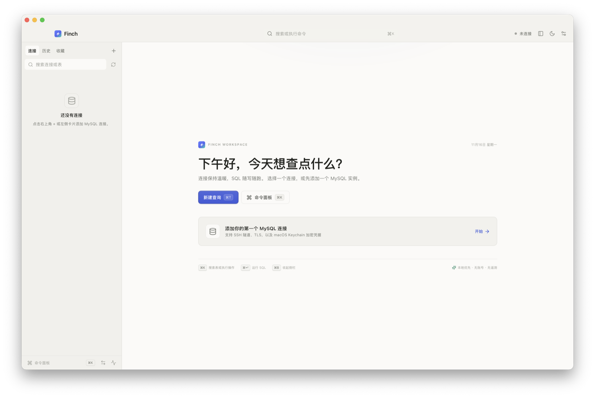
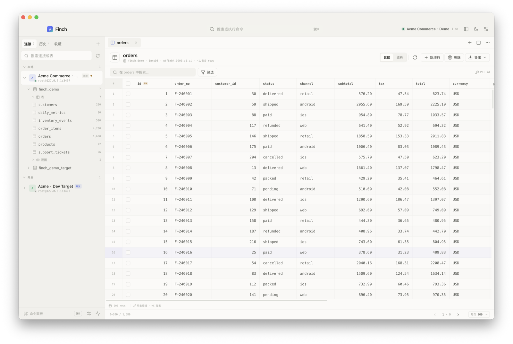
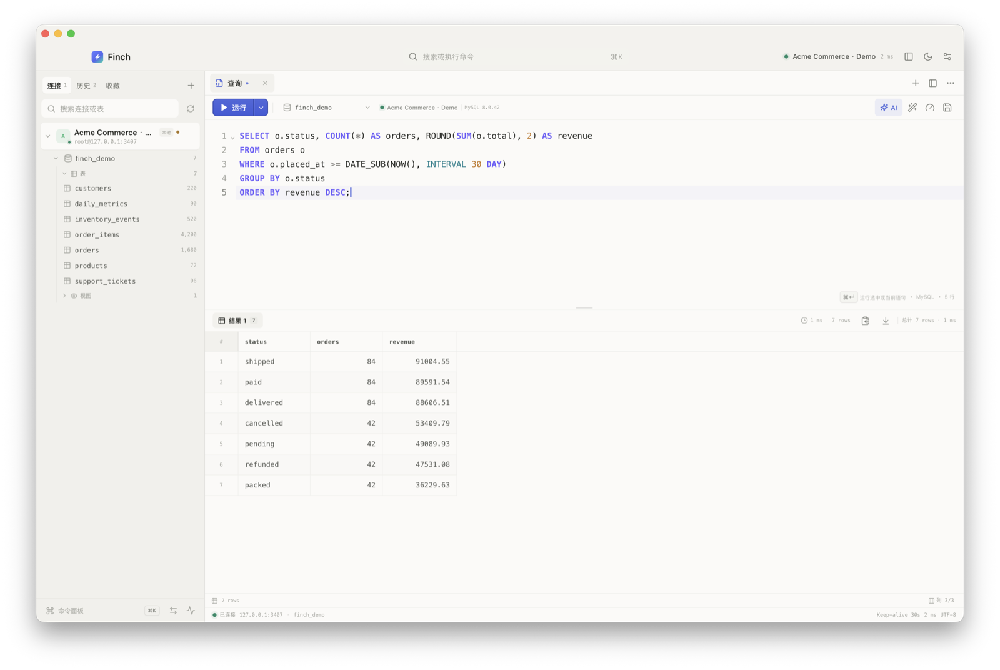
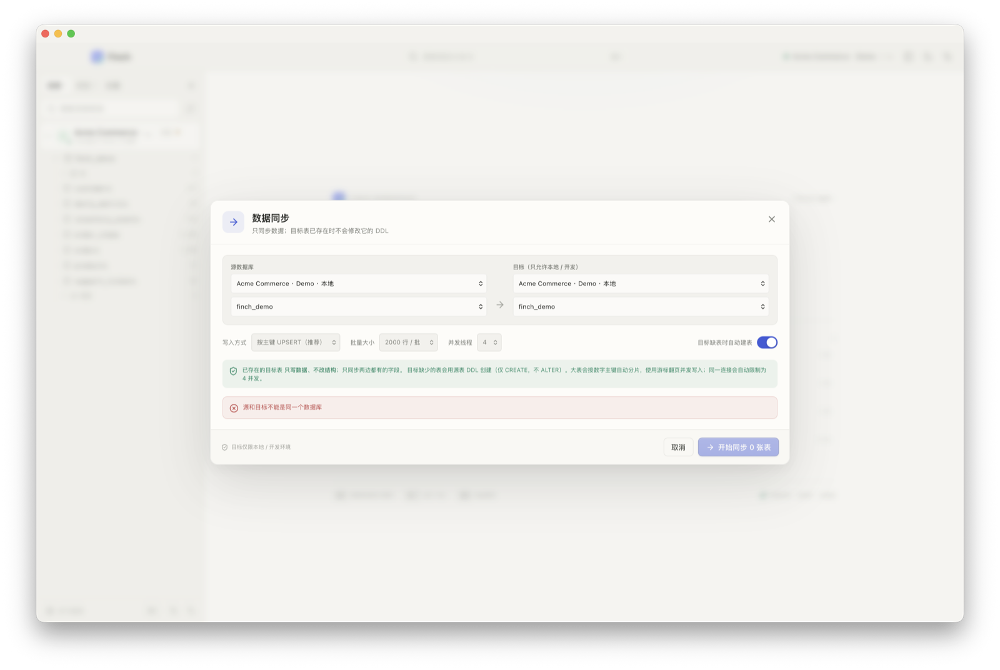
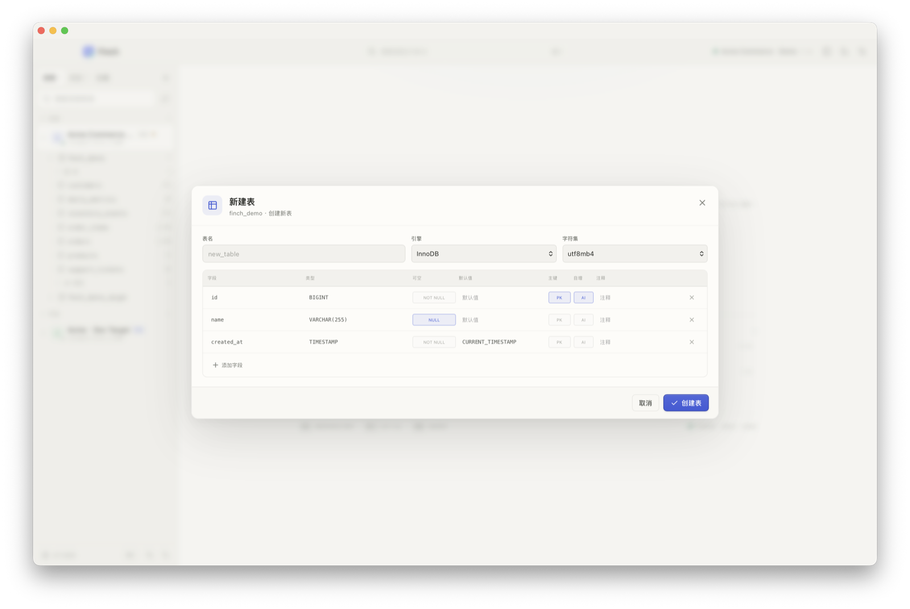
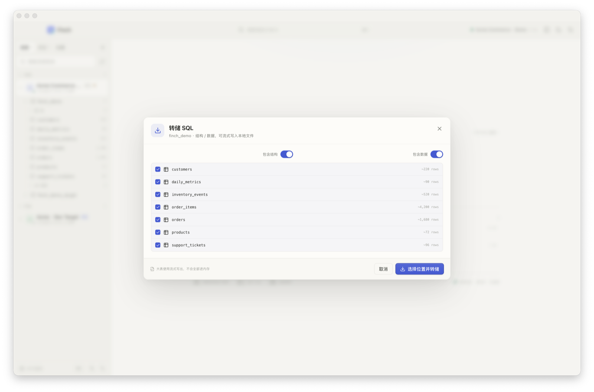
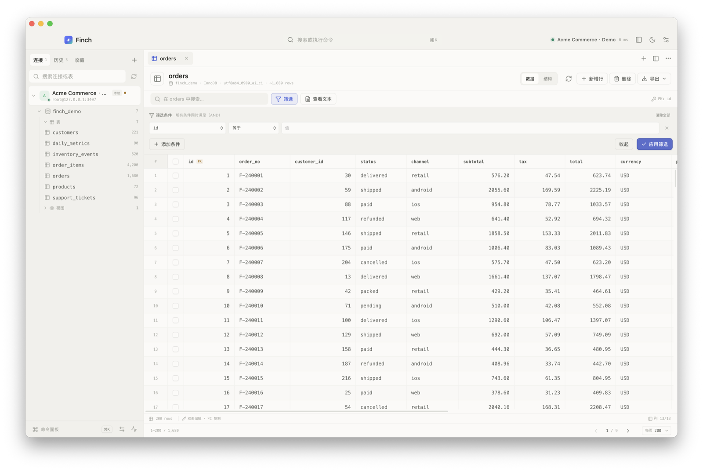
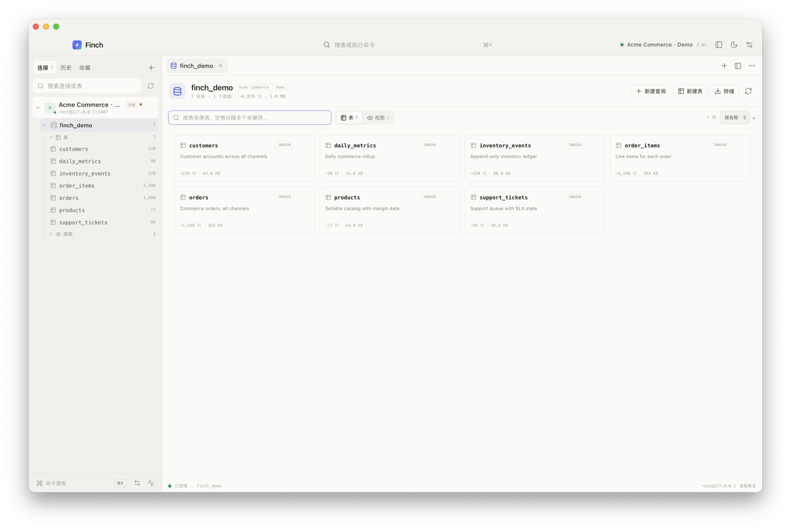

<p align="center">
  
</p>

<h1 align="center">Finch</h1>

<p align="center">
  <strong>MySQL，不等待。</strong><br />
  Tauri 2 + Rust 的轻量 macOS MySQL 工作台。
</p>

<p align="center">
  
  
  
  
  
</p>

---

## 为什么是 Tauri

Finch 最初是一版 Electron 原型。功能能跑，但**安装包 128 MB、常驻内存约 470 MB**，对一个每天打开的数据库客户端来说太重了。v0.3 已迁移到 **Tauri 2 + Rust**：

| 指标 | Electron 原型 | 当前 Tauri |
| --- | --- | --- |
| 安装包 | ~128 MB | **7.2 MB DMG / 19.5 MB .app** |
| 运行时 | Chromium | macOS 系统 WKWebView |
| 数据库 / SSH | Node `mysql2` | Rust `mysql_async` |
| 常驻内存 | ~470 MB | 主进程约 120 MB + 系统 WebKit |

界面参考 Rill 的轻量思路：收起侧栏、减少层级、系统字体、键盘优先。视觉上重新做了一轮减重：无左侧图标栏、单一侧栏、合并状态栏、低频信息收进 tooltip。

---

## 安装

从 [GitHub Releases](https://github.com/pdxjie/finch/releases) 下载最新的 `Finch-*-arm64.dmg`，打开后把 Finch 拖进「应用程序」。

也可以从源码构建（需要 Node.js 20+、Rust 1.80+、Xcode Command Line Tools）：

```bash
npm install
npm run package:mac
open src-tauri/target/release/bundle/dmg/Finch_0.4.1_aarch64.dmg
```

> 仓库不提交构建产物；`release/`、`dist/`、`src-tauri/target/` 都在 `.gitignore` 中。

当前为本地 ad-hoc 签名构建，首次打开若被 macOS 拦截，右键 `Finch.app` → **打开**。

> 完整产品判断、性能设计和同步安全边界见 [docs/ANALYSIS.md](docs/ANALYSIS.md)。

## 截图



| 表数据 | 查询结果 |
| --- | --- |
|  |  |

| 数据同步 | 表设计器 |
| --- | --- |
|  |  |

| 转储 | 内联筛选 |
| --- | --- |
|  |  |

点击侧栏数据库后的表浏览页（卡片网格、可按表名实时筛选）：



---

## 功能

### 连接与分类

- 多连接，环境分类：**本地 / 开发 / 预发 / 生产**
- 测试连接、延迟、版本、字符集
- SSH 隧道（私钥认证）、TLS
- 密码与 API Key 写入 **macOS Keychain**，配置文件不含明文
- 只读模式（Rust 统一校验，覆盖 CTE 写语句、可执行注释、文件导出；保存后立即生效）
- **生产环境二次确认**：UPDATE / DELETE / DROP / ALTER / TRUNCATE 等危险操作，无论表内操作还是手写 SQL，都必须确认；后端同样强制校验
- 每连接独立心跳间隔，尊重「自动重连」开关；手动断开后旧心跳不会把连接拉回来
- 连接行悬停可一键**断开**（停止心跳、关闭 SSH 隧道、释放连接池与带宽）；右键菜单与命令面板同样提供
- 连接超时、Keep-alive 间隔

### AI SQL

- 可配置多个 AI 服务商，三种**线路协议**任选：
  - **Chat Completions** → `POST /chat/completions`（OpenAI、DeepSeek、Moonshot、各类兼容网关）
  - **Responses API** → `POST /responses`（OpenAI 原生 Responses，支持 reasoning 输出）
  - **Anthropic Messages** → `POST /messages`（`x-api-key` + `anthropic-version`）
- 协议与厂商解耦：同一厂商可同时配置 Chat 与 Responses 两条线路
- 每个服务商独立 Base URL / Model / 协议 / API Key
- 生成时读取**当前数据库真实表结构和字段**，用准确的表名/列名写 SQL
- **⌘P 唤起轻量输入框**，Enter 提交后转圈并流式写入编辑器，支持停止生成和 Esc 关闭
- 保留已有 SQL 并追加生成内容；生成完成后自行检查再运行，异常中断保留已收到的部分
- API Key 不进入前端配置文件

### 查询性能与结果工具

- Rust `mysql_async` 流式读取结果，最多 5,000 行
- 无 `LIMIT` 的 `SELECT` 自动加上限；达到上限立即断开该连接，避免留下 pending result
- 结果网格虚拟化，只渲染视口内的行
- **显示 / 隐藏任意结果列**，列选择器按查询结果独立保存
- **查看文本**：选中单元格后在底部推起一个抽屉展示完整内容，自动识别 JSON 并格式化，不遮挡数据
- 表数据服务端分页、**内联筛选面板**、搜索；单页默认 200 行，可调
- 筛选、新增、删除、更新后**在底部显示实际 SQL**，SQL 末尾有复制按钮，超长时省略、悬停看全文；工具栏可随时查看当前 SELECT
- 打开表时先出数据、`COUNT(*)` 后台补总数，大表不再等统计完成
- 筛选条件支持中文运算符：等于、不等于、包含、开头是、是 NULL、介于、在列表中…
- 索引列表显示方法类型（BTREE / HASH / FULLTEXT / SPATIAL）与联合索引列顺序
- 查询线程可 `KILL QUERY` 取消
- CodeMirror 6 + MySQL 方言补全
- **中文 SQL 代码提示**：关键字、函数、表、视图、字段都带中文说明、函数签名和**可直接照抄的示例 SQL**
- 上下文感知：`FROM` / `JOIN` 只优先提示表，`SELECT` / `WHERE` 优先提示字段，`alias.` 只提示该表字段
- 输入 `.` 自动弹出字段提示；10 个常用 SQL 片段（查询、JOIN、建表、CTE 等）
- `Tab` 接受补全（不再错位），`↑↓` 选择，`Esc` 关闭；列表底部常驻快捷键提示
- 多语句执行、执行计划、SQL 格式化、历史、收藏
- 查询页可切换 MySQL 连接，保留 SQL，刷新目标数据库和补全；查询执行期间锁定连接
- 双击 tab bar 空白处新建查询
- **点击侧栏数据库**在右侧打开表浏览页：卡片网格自适应一行显示多张表，含注释、引擎、行数与大小，可按表名实时筛选和排序
- **单击表卡片**从右侧滑出明细栏：字段、索引、外键、触发器、引擎/行数/大小/排序规则与完整 DDL；DDL 用专用的建表格式化（一条定义一行、两空格缩进、不折行、横向滚动），只读代码视图带行号与语法高亮，可切原始文本；可复制或直接打开数据；**双击**打开数据页
- **多选批量转储**：卡片勾选框 / ⌘ 点击 / 工具栏「全选」选择多张表，点「批量转储」一次导出所选表的结构、数据或两者
- 转储支持**合并为一个 SQL 文件**或**每表一个 SQL 文件**（选目录自动命名），并可先**预览所选表的 DDL**
- DDL 视图可选中文本用 ⌘C 复制；字段列表悬停可复制单个字段定义
- 表浏览页的筛选、排序、表/视图切换与选中表会保存在标签页上，进入表数据再返回不会丢失

### 局域网传输（Beta）

- 同一局域网内自动发现其他 Finch；请求 → 对方选择连接并接受 → 建立双向会话
- 双方都可以发送**表**或**普通文件**
- 文件流式落盘、SHA-256 校验、不限大小；接收目录在会话建立时选择
- 表只写两边共同字段并按主键 UPSERT；缺表按源结构创建，已有表不做 ALTER
- **生产连接不会出现在选择列表，后端也会拒绝**
- TLS 1.3 加密，密码与 Keychain 永不出本机；会话需对方明确接受

### 数据同步

- 源连接 → 目标连接，目标**只能是「本地」或「开发」**（Rust 后端二次校验）
- 只同步数据；已存在的目标表**不会 ALTER / 改 DDL**
- 目标缺表时，按源表 `SHOW CREATE TABLE` 创建（`CREATE TABLE IF NOT EXISTS`）
- 自动取两边同名字段，跳过目标不存在的列并报告
- UPSERT / 追加 / 清空后写入三种模式
- 批量写入默认 2,000 行/批，可选 500 – 10,000 行
- 单列数字主键大表自动**按主键范围分片**，每个分片使用 **keyset 游标翻页**，避免 OFFSET 越翻越慢；复合主键及其他表使用有界流式读取，避免遗漏记录
- 多表 / 多分片**并发写入**，默认 4 并发，最高 8；同一连接自动限制 4，避免连接池互相等待
- 关闭外键/唯一检查以提升导入速度，每个工作连接结束后恢复
- 同步过程通过事件推送进度，完成后刷新目标 schema

### 表结构与转储

- 可视化建表：字段、类型、可空、默认值、主键、自增、注释
- **索引编辑**：普通 / 唯一 / 全文 / 空间索引，多字段联合索引按选择顺序排列，索引名可留空自动生成
- 编辑表结构：加字段、改类型/默认值/注释、删字段、重命名表
- 删除表（二次确认）
- 转储结构和/或数据到 `.sql`，按表生成 `CREATE TABLE` / 批量 `INSERT`
- 流式写文件，不把整库加载进内存

### 交互细节

- **外观可配置**：界面字体与代码字体（预设 + 自定义）、界面字号（11–17px）、整体缩放、主题色（8 个预设 + 取色器）、动画（完整 / 柔和 / 关闭），全部即时生效并持久化
- 按钮系统统一：工具栏按钮改为无边框 ghost、主按钮纯色 + 轻投影、圆角与高度统一（28/26px），增加 `focus-visible` 焦点环
- 所有下拉框改为**自绘控件**：圆角浮层、选中勾、键盘 ↑↓/Enter/Esc、自动避开屏幕边缘，不再是 macOS 原生样式
- 所有图标与按钮使用**即时 tooltip**：悬停约 0.1 秒出现，跟随鼠标、不会被容器裁剪
- 卡片、侧栏的行内操作改为**右键 / 「⋯」就地菜单**，菜单从光标处弹出并自动避开屏幕边缘

### 其他

- 保存查询自定义命名、更新、收藏
- 查询历史（本机最近 500 条）
- 服务器概览：QPS、连接、慢查询、数据量、进程、KILL
- 命令面板、快捷键、Light / Dark
- 无账号、无云端、无遥测

---

## 快捷键

| 动作 | 快捷键 |
| --- | --- |
| 命令面板 | `⌘K` |
| 新建查询 | `⌘T` |
| 新建连接 | `⇧⌘N` |
| 运行当前语句 / 选中内容 | `⌘↵` |
| 运行全部 | `⇧⌘↵` |
| 执行计划 | `⌘E` |
| AI 生成 SQL | `⌘P` |
| 格式化 | `⇧⌘F` |
| 取消查询 | `⌘.` |
| 关闭标签页 | `⌘W` |
| 切换侧栏 | `⌘B` |
| 切换主题 | `⇧⌘L` |

---

## 开发

环境：macOS 12+、Node 20+、Rust 1.80+、Xcode Command Line Tools。

```bash
npm install
npm run app:dev      # Tauri 开发模式（Vite + WKWebView）
npm run build        # 只构建 Web 前端
npm run package:mac  # 构建 .app + .dmg
```

Tauri 产物：

```text
src-tauri/target/release/bundle/macos/Finch.app
src-tauri/target/release/bundle/dmg/Finch_0.3.10_aarch64.dmg
```

如只需应用：

```bash
npm run app:build
```

### 目录

```text
src/                     React 19 + TypeScript UI
  components/            侧栏、编辑器、网格、同步/AI/表设计器/Select/Tooltip
  store.ts               Zustand 工作区状态（连接、标签、AI 流式、查询）
  lib/aiStreaming.ts     流式 SQL 清洗（去围栏、解释转注释）
  lib/sqlCompletions.ts  中文 SQL 补全与上下文推断
src-tauri/               Tauri 2 应用
  src/lib.rs             Tauri 命令注册、心跳调度、测试模块
  src/db.rs              mysql_async 连接池 / 会话 / 行序列化
  src/query.rs           查询执行、超时、取消、结果预算、历史
  src/sql.rs             SQL 拆分 / 首关键字 / 只读判定（唯一实现）
  src/schema.rs          元数据、表数据、COUNT、服务器指标
  src/sync.rs            安全数据同步（分片 + 并发）
  src/ddl.rs             建表 / 改表 / 删表 / 索引
  src/dump.rs            流式 SQL 转储
  src/ai.rs              AI 协议、流式请求、schema discovery
  src/ai_stream.rs       SSE 解码与增量解析
  src/heartbeat.rs       心跳与自动重连决策
  src/store.rs           本地配置 + macOS Keychain
  src/ssh.rs             SSH 隧道
scripts/
  seed-demo.sql / start-demo-db.sh
  test-ai-stream.cjs / test-query-client.cjs
```

完整模块职责、数据流与扩展步骤见 **[docs/CODE_MAP.md](docs/CODE_MAP.md)**。

### 演示数据库

```bash
./scripts/start-demo-db.sh
```

在 Finch 中添加：

| Host | Port | User | Password | Database |
| --- | --- | --- | --- | --- |
| `127.0.0.1` | `3407` | `root` | 空 | `finch_demo` |

---

## 测试

查询执行专项（无需数据库）：

```bash
npm run test:query-client
```

0.3.10 的中文 SQL 挂起修复、31 行多表关联回归和实测耗时见 [性能回归记录](test-reports/sql-performance-0.3.10.md)。

```bash
npm run verify                 # 类型检查 + 三个测试套件
npm run test:rust              # 仅 Rust
npm run test:ai-stream         # AI 流式 store
npm run test:query-client      # 查询 IPC / 取消 / 切换连接
```

Rust 集成测试覆盖：

- 真实 MySQL 查询、数值/日期序列化
- SQL 语句切分（引号、注释、多语句）
- 数据同步：目标缺表建表、全量写入、二次同步不改变目标已有 DDL、Upsert 更新
- 6,000 行数字主键表按主键分片 + keyset 游标 + 4 并发同步
- 中文筛选运算符（包含、BETWEEN）
- 建表 / 改表 / 删表
- 流式转储结构与数据
- 同步后目标表多出的列仍保留

测试需要本机 demo MySQL 运行在 `127.0.0.1:3407`；未启动时会自动跳过集成测试。

---

## 数据与隐私

```text
~/Library/Application Support/Finch/
  connections.json     # 连接配置（不含密码）
  settings.json
  history.json          # 最近 500 条
  snippets.json
  ai_providers.json     # Base URL / model（不含 API Key）
```

- 密码、SSH passphrase、AI API Key 存入 macOS Keychain
- 无账号、无遥测、无云端
- AI 只把 SQL 文本流式写进编辑器，不会自动执行；是否运行由你决定

---

## 已知限制

- SSH 目前支持私钥认证；SSH 密码认证待实现
- 表设计器暂不管理外键的新增/删除
- 分片同步使用单个数字主键；字符串/复合主键表仍按整表流式+多表并发
- 转储按表导出，不含存储过程/视图/事件
- AI 生成结果依赖服务商质量，执行前请自己复核
- 未签名/未公证构建首次打开需要右键 → 打开

---

## License

MIT
